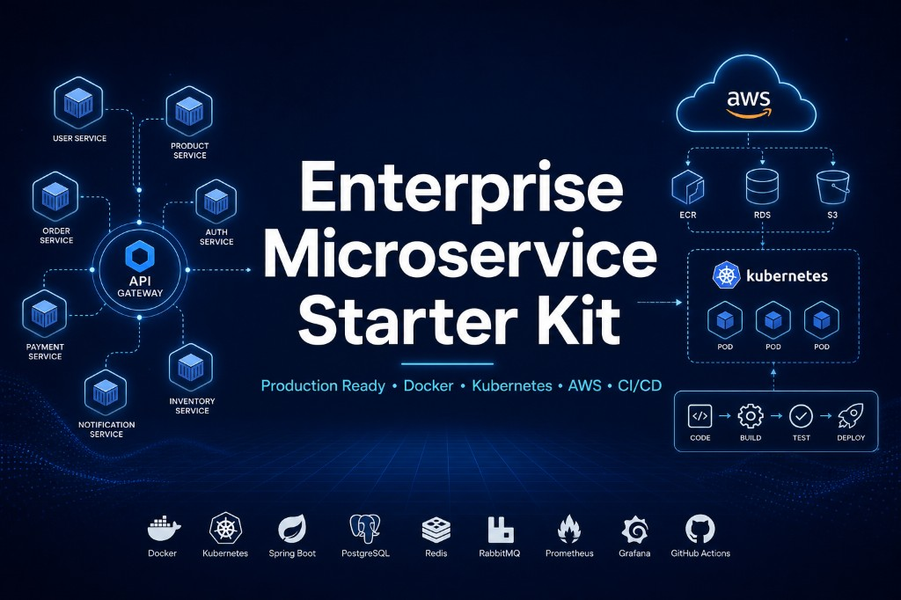

# Microservice Starter Kit — Community Edition

**Version 1.1.0** · Free public edition by **[CyberInfoware](https://www.cyberinfoware.com)** · [`CHANGELOG.md`](CHANGELOG.md) · [`LICENSE.md`](LICENSE.md) · [`SECURITY.md`](SECURITY.md) · [`EDITIONS.md`](EDITIONS.md)

High-quality NestJS microservice boilerplate for learning, demos, and local development — **Keycloak SSO**, **Next.js storefront** (Stripe checkout), **Angular admin console**, **API gateway**, **catalog + order + notification services**, **RabbitMQ**, **Redis**, and **PostgreSQL** — all runnable with a single Docker Compose command.

> This is the **Community Edition**. It showcases production-grade architecture and coding standards. Kubernetes, Terraform, Helm, CI/CD, and cloud deployment assets ship in the **Premium** editions — see [Upgrade to Premium](#upgrade-to-premium) or visit [www.cyberinfoware.com](https://www.cyberinfoware.com).

## Community vs Premium

| Feature                  | Community | Premium |
| ------------------------ | --------- | ------- |
| Docker Compose           | ✅         | ✅       |
| API Gateway              | ✅         | ✅       |
| NestJS Microservices     | ✅         | ✅       |
| RabbitMQ                 | ✅         | ✅       |
| Redis                    | ✅         | ✅       |
| PostgreSQL               | ✅         | ✅       |
| Authentication           | ✅         | ✅       |
| Kubernetes               | ❌         | ✅       |
| Helm Charts              | ❌         | ✅       |
| Terraform                | ❌         | ✅       |
| GitHub Actions           | ❌         | ✅       |
| Production CI/CD         | ❌         | ✅       |
| Cloud Deployment         | ❌         | ✅       |
| Enterprise Documentation | ❌         | ✅       |

Premium editions (V1 / V2 / V3): [Products & pricing](https://www.cyberinfoware.com/products#pricing) · Full matrix: [`EDITIONS.md`](EDITIONS.md)

## What's included

| Module | Tech | Port | Purpose |
|--------|------|------|---------|
| **SSO / OIDC** | Keycloak 25 | `8080` | Identity provider with pre-configured realm, clients, and demo users |
| **Next.js app** | Next.js 16 + NextAuth v5 | `3000` | Customer storefront — catalog, cart, Stripe checkout, `/orders` |
| **Angular app** | Angular 19 + keycloak-angular | `4200` | Admin console — sidebar: dashboard, products, orders, notifications |
| **API gateway** | NestJS + JWT (jose) | `3001` | Auth, role checks, and routing to backend services |
| **Catalog service** | NestJS + TypeORM | `4000` | Products and analytics (`catalog_db`) |
| **Order service** | NestJS + TypeORM | `4001` | Orders API (`order_db`) |
| **Notification service** | NestJS + RabbitMQ + SMTP | `4002` | Real-time order confirmation emails (`notification_db`) |
| **Redis** | Redis 7 | `6379` | Caching for backend services |
| **RabbitMQ** | RabbitMQ 3 | `5672` | Event bus (order → notification) |
| **PostgreSQL** | Postgres 16 | `5432` | keycloak, catalog_db, order_db, notification_db |

## Port mapping

### Docker Compose (local)

| Service | Host (your machine) | Container port | Browser / client URL |
|---------|---------------------|----------------|----------------------|
| **PostgreSQL** | `127.0.0.1:5432` | `5432` | DB clients (TablePlus, psql) |
| **Keycloak** | `8080` | `8080` | http://localhost:8080 |
| **Next.js app** | `3000` | `3000` | http://localhost:3000 |
| **Angular app** | `4200` | `80` | http://localhost:4200 |
| **API Gateway** | `3001` | `3001` | http://localhost:3001 |
| **Catalog service** | `4000` | `4000` | http://localhost:4000/docs (Swagger) |
| **Order service** | `4001` | `4001` | http://localhost:4001/docs (Swagger) |
| **Notification service** | `4002` | `4002` | http://localhost:4002/docs (Swagger) |
| **Redis** | `127.0.0.1:6379` | `6379` | Internal cache |
| **RabbitMQ** | `127.0.0.1:5672` | `5672` | http://localhost:15672 (mgmt UI) |

Format: `HOST_PORT:CONTAINER_PORT` (from `docker-compose.yml`).

### Inside Docker network (service-to-service)

Containers talk to each other by **service name**, not `localhost`:

| From | To | URL |
|------|-----|-----|
| Next.js app | API Gateway | `http://api-gateway:3001` |
| Next.js app | Keycloak (server-side) | `http://keycloak:8080` |
| API Gateway | Catalog service | `http://catalog-service:4000` |
| API Gateway | Order service | `http://order-service:4001` |
| API Gateway | Keycloak JWKS | `http://keycloak:8080/realms/ms-realm/protocol/openid-connect/certs` |
| Catalog service | Order service | `http://order-service:4001` |
| Order service | Catalog service | `http://catalog-service:4000` |
| Catalog / Order services | PostgreSQL | `postgres:5432` |
| Catalog / Order services | Keycloak JWKS | `http://keycloak:8080/.../certs` |
| Keycloak | PostgreSQL | `postgres:5432` |

Browsers and Postman use **localhost** ports; apps inside Docker use the **service names** above.

> **Premium only:** Kubernetes manifests, Helm charts, Terraform, GitHub Actions, and cloud deploy guides are included in Premium editions from [CyberInfoware](https://www.cyberinfoware.com).

## Quick start

### Prerequisites

- [Docker Desktop](https://www.docker.com/products/docker-desktop/) (or Docker Engine + Compose v2)
- 4 GB+ free RAM recommended for first build

### 1. Clone and configure

```bash
git clone git@github.com:jaswantjatav/microservice-kit.git microservice-kit
cd microservice-kit

# Copy environment files from the tracked examples
cp .env.example .env                                    # Postgres, Keycloak, optional SMTP
cp nextjs-app/.env.local.example nextjs-app/.env.local  # Keycloak client + optional Stripe
cp catalog-service/.env.example catalog-service/.env    # optional — only for Grafana telemetry
```

Open `.env` and set passwords plus optional integrations:

```env
POSTGRES_USER=postgres
POSTGRES_PASSWORD=CHANGE_ME          # ← set your own
POSTGRES_DB=keycloak
KEYCLOAK_ADMIN=admin
KEYCLOAK_ADMIN_PASSWORD=CHANGE_ME    # ← set your own
OTEL_ENABLED=false                   # master telemetry switch (see Observability below)

# Email — off by default (see user-guide/Microservice-Starter-Kit-Guide.md §6.13)
SMTP_ENABLED=false
SMTP_HOST=
SMTP_PORT=587
SMTP_USER=
SMTP_PASS=
SMTP_SECURE=false
EMAIL_FROM=Microservice Storefront <orders@localhost>
```

Next.js Keycloak client secrets live in `nextjs-app/.env.local`. Stripe checkout is **off by default**:

```env
STRIPE_ENABLED=false
STRIPE_SECRET_KEY=
STRIPE_PUBLISHABLE_KEY=
NEXT_PUBLIC_STRIPE_PUBLISHABLE_KEY=
```

See [user-guide/Microservice-Starter-Kit-Guide.md §6.12–6.13](user-guide/Microservice-Starter-Kit-Guide.md#612-stripe-payment-gateway-checkout--optional) for enabling Stripe and SMTP.

### 2. Start the full stack

```bash
docker compose up --build -d
```

First startup takes **60–90 seconds** while Keycloak imports the realm and the catalog service seeds **four sample products** (Wireless Headphones, Smart Watch, USB-C Hub, Mechanical Keyboard).

### 3. Open the apps

| App | URL |
|-----|-----|
| Next.js Storefront | http://localhost:3000 |
| Angular Admin Console | http://localhost:4200 |
| Keycloak Admin | http://localhost:8080 |
| API Gateway | http://localhost:3001 |
| Catalog Service (Swagger) | http://localhost:4000/docs |
| Order Service (Swagger) | http://localhost:4001/docs |
| Notification Service (Swagger) | http://localhost:4002/docs |

### 4. Sign in with demo users

| Username | Password | Role | Capabilities |
|----------|----------|------|--------------|
| `manager` | `manager123` | manager | Admin Console: product CRUD, analytics, orders & email log; can also shop on storefront |
| `customer` | `customer123` | customer | Storefront: browse, cart, Stripe checkout; Admin Console: read-only inventory + own orders |

Demo users have **no prefilled email** in Keycloak. Add an email under Keycloak Admin → **Users** for order confirmation delivery.

**Keycloak admin console:** `admin` / value from root `.env` (`KEYCLOAK_ADMIN_PASSWORD`)

## Architecture

```
Browser
  ├── Next.js (3000) ──► Keycloak OIDC login
  ├── Angular (4200) ──► Keycloak OIDC login
  └── Both apps ──────► API Gateway (3001)
                              │ JWT + roles + rate limit
                              ├──► Catalog service (4000) ──► catalog_db
                              │         │ Redis cache
                              │         └──► Order service (4001) — order stats
                              ├──► Order service (4001) ──► order_db
                              │         │ Redis + RabbitMQ publish
                              │         └──► Catalog service — product lookup
                              └──► Notification service (4002) ──► notification_db
                                        ▲ Redis
                                        │ RabbitMQ consume (order.created)
                                        │ SMTP (optional) → customer inbox
Keycloak (8080) ──► PostgreSQL (keycloak)
PostgreSQL ───────► catalog_db, order_db, notification_db
Redis (6379) ─────► catalog, order, notification services
RabbitMQ (5672) ──► order-service → notification-service (EDA)
```

### Observability (optional)

OpenTelemetry → Grafana Cloud (backends export direct; Angular exports via the gateway OTLP proxy). **Off by default** — no OTLP network calls are made anywhere.

To enable: set `OTEL_ENABLED=true` in the root `.env` (the authoritative switch for all services and both frontends) and add your Grafana Cloud credentials to `catalog-service/.env` (see `catalog-service/.env.example`), then rebuild.

### Request flow

1. User clicks **Sign in** (Next.js) or **Login with SSO** (Angular).
2. Browser redirects to Keycloak (`ms-realm`).
3. After login, the app receives an access token (JWT).
4. App calls `GET /products` on the API gateway with `Authorization: Bearer <token>`.
5. Gateway validates the JWT against Keycloak JWKS, extracts roles, and proxies to catalog-service or order-service.
6. Manager-only routes (`POST`, `PATCH`, `DELETE /products`) require the `manager` realm role.

## Dashboard features

### Customer Storefront (Next.js, port 3000)

- **Logged out** — marketing landing at `/` + **Sign in**
- **Logged in** — catalog + cart at `/products`, Stripe checkout at `/checkout`, **My Orders** at `/orders`, profile at `/profile`
- **No catalog CRUD** — add, edit, delete products are **Admin Console only** (Angular)
- **Checkout UI** — cart → `/checkout` → success or failed page
- **Silent SSO** — refresh picks up an existing Keycloak session (skipped after logout)
- **Rebrand** — edit `nextjs-app/content/landing.ts` or set `LANDING_*` env vars

### Admin Console (Angular, port 4200)

Left sidebar navigation (`admin-shell`):

| Page | Managers | Customers |
|------|----------|-----------|
| **Dashboard** | Statistics only | Restricted summary |
| **Products** | CRUD + JSON export | Read-only inventory |
| **Orders** | All orders | Own orders |
| **Notifications** | Email delivery log | Hidden |
| **Profile** | Account & permissions | Account & permissions |

- Order status is **`confirmed`** automatically after successful Stripe payment
- Notifications are logged even when SMTP is disabled (`skipped`)

## Optional integrations — Stripe checkout & SMTP email

Both features are **disabled by default**. Each requires an **enable flag plus credentials** in the correct env file.

| Integration | What it does | Enable flag | Config file |
|-------------|--------------|-------------|-------------|
| **Stripe checkout** | Real card payments via Stripe Payment Element; order placed only after payment succeeds | `STRIPE_ENABLED=true` | `nextjs-app/.env.local` |
| **SMTP order emails** | Real HTML confirmation emails sent when an order is placed | `SMTP_ENABLED=true` | root `.env` |

### Enable Stripe checkout

1. Copy `nextjs-app/.env.local.example` → `nextjs-app/.env.local`
2. Get test keys from [Stripe Dashboard → API keys](https://dashboard.stripe.com/test/apikeys) (test mode)
3. Set in `nextjs-app/.env.local`:

```env
STRIPE_ENABLED=true
STRIPE_SECRET_KEY=sk_test_...
STRIPE_PUBLISHABLE_KEY=pk_test_...
NEXT_PUBLIC_STRIPE_PUBLISHABLE_KEY=pk_test_...
```

`STRIPE_PUBLISHABLE_KEY` is preferred for Docker (runtime). You can set both to the same `pk_test_…` value.
4. Restart: `docker compose up -d --build nextjs-app`
5. Test with card `4242 4242 4242 4242`

When disabled: cart shows **Checkout unavailable**; no orders via payment flow.

### Enable SMTP email delivery

1. Copy `.env.example` → `.env` (root)
2. Set in root `.env`:

```env
SMTP_ENABLED=true
SMTP_HOST=smtp.gmail.com
SMTP_PORT=587
SMTP_USER=your.email@gmail.com
SMTP_PASS=your_gmail_app_password
SMTP_SECURE=false
EMAIL_FROM=Microservice Storefront <your.email@gmail.com>
```

3. Restart: `docker compose up -d --build notification-service`
4. Add customer **email** in Keycloak Admin → Users (demo users have none by default)
5. Place a paid order → check Admin Console **Notifications** for status **`sent`**

When disabled: email row is logged with status **`skipped`**; no SMTP send.

For Gmail use an [App Password](https://myaccount.google.com/apppasswords). For dev without real inboxes, use [Mailtrap](https://mailtrap.io).

**Full step-by-step guide:** [Stripe §6.12](user-guide/Microservice-Starter-Kit-Guide.md#612-stripe-payment-gateway-checkout--optional) · [SMTP §6.13](user-guide/Microservice-Starter-Kit-Guide.md#613-real-email-delivery-smtp--optional)

## Checkout & order flow

```
Cart (3000) → Checkout → /checkout (Stripe Payment Element) → /checkout/success | /checkout/failed
                                      ↓ (on success)
                            order-service (status: confirmed)
                                      ↓
                            RabbitMQ order.created
                                      ↓
                            notification-service → SMTP email (if enabled) + DB log
```

- Orders are **`confirmed` immediately** after payment — no manager approve/cancel in the Admin Console.
- Product catalog CRUD is **Admin Console only** — the storefront is shopping-only.

## Role-based demo flow

1. Sign in as **manager** on Admin Console → verify **four seeded products** (or add more).
2. Enable Stripe + SMTP if desired (see [user-guide/Microservice-Starter-Kit-Guide.md §6.12–6.13](user-guide/Microservice-Starter-Kit-Guide.md#612-stripe-payment-gateway-checkout--optional)); add customer email in Keycloak for live emails.
3. Sign in as **customer** on Storefront → add items → **Checkout** → pay (test card `4242 4242 4242 4242`).
4. Open Admin Console as **manager** → order **confirmed**; email **sent** or **skipped**.
5. Customer → Storefront account menu → **My Orders** lists the purchase.

## API reference (via gateway)

Base URL: `http://localhost:3001`

All routes require a valid Bearer token except health-style probes.

**Swagger UI (per service, dev mode):** Catalog http://localhost:4000/docs · Order http://localhost:4001/docs · Notification http://localhost:4002/docs — see [user-guide/Microservice-Starter-Kit-Guide.md §8.1](user-guide/Microservice-Starter-Kit-Guide.md#81-swagger-ui-per-microservice) for screenshots.

| Method | Path | Role | Description |
|--------|------|------|-------------|
| `GET` | `/products` | any authenticated | List products |
| `GET` | `/products/:id` | any authenticated | Get one product |
| `POST` | `/products` | manager | Create product |
| `PATCH` | `/products/:id` | manager | Update product |
| `DELETE` | `/products/:id` | manager | Delete product |
| `POST` | `/orders` | any authenticated | Place order (storefront BFF — requires Stripe payment when enabled) |
| `GET` | `/orders/mine` | any authenticated | List your orders |
| `GET` | `/orders` | manager | List all orders |
| `PATCH` | `/orders/:id/status` | manager | Update order status (API retained; UI approve/cancel removed) |
| `GET` | `/analytics/summary` | manager | Inventory and operations analytics |
| `GET` | `/notifications` | manager | Email delivery log (sent, failed, skipped) |

Example (after obtaining a token from Keycloak):

```bash
curl -H "Authorization: Bearer $TOKEN" http://localhost:3001/products
```

## Project structure

```
.
├── docker-compose.yml      # Orchestrates all local services
├── .env.example            # Copy → .env (Postgres, Keycloak, optional SMTP)
├── CHANGELOG.md / LICENSE.md / SECURITY.md / VERSION / EDITIONS.md
├── docs/                   # GitHub Pages marketing landing
├── keycloak/               # Lattice theme + realm import + Dockerfile
├── postgres/               # init.sql (databases + roles)
├── nextjs-app/             # Next.js storefront (catalog, cart, checkout, /orders)
├── angular-app/            # Angular admin console
├── api-gateway/            # NestJS JWT gateway
├── catalog-service/        # Products, analytics
├── order-service/          # Orders + RabbitMQ publisher
├── notification-service/   # RabbitMQ consumer + SMTP email delivery
├── scripts/                # Local helpers (e.g. Keycloak forgot-password + SMTP)
└── user-guide/             # Community developer guide + screenshots
```

## Local development (without Docker)

Run infrastructure only:

```bash
docker compose up postgres keycloak -d
```

Then start each service locally:

```bash
# Catalog service
cd catalog-service && npm install && npm run start:dev

# Order service
cd order-service && npm install && npm run start:dev

# API gateway
cd api-gateway && npm install && npm run start:dev

# Next.js
cd nextjs-app && npm install && npm run dev

# Angular
cd angular-app && npm install && npm start
```

Ensure Keycloak is at `http://localhost:8080` and the gateway at `http://localhost:3001`.

## Customization guide

### Add a new Keycloak client

1. Edit `keycloak/init-realm.json` — add a client under `clients`.
2. Set `redirectUris`, `webOrigins`, and `post.logout.redirect.uris`.
3. Remove the Keycloak volume to re-import: `docker compose down -v` (destroys DB data).

### Add a new backend service

1. Create a service under e.g. `inventory-service/`.
2. Register it in `docker-compose.yml`.
3. Add proxy routes in `api-gateway/src/`.
4. Point the gateway env var (e.g. `INVENTORY_SERVICE_URL`) at the new container.

### Change demo passwords

Update `keycloak/init-realm.json` user credentials and rebuild, or change them in the Keycloak admin UI.

## Troubleshooting

| Issue | Fix |
|-------|-----|
| Keycloak shows stock login UI | Rebuild Keycloak: `docker compose up -d --build keycloak`. For a stale realm DB, run `docker compose down -v` then `up --build -d` so the Lattice theme and realm import apply cleanly. |
| Keycloak login loop | Clear site data for `localhost` (ports 3000/8080/4200), or open http://localhost:3000/clear-cookies.html then sign in again. |
| HTTP **431** (Request Header Fields Too Large) | Same as above — Keycloak + Auth.js cookies piled up on `localhost`. Clear cookies, then retry logout/checkout. |
| `401` from API gateway | Token expired — log out and back in. Check Keycloak is healthy on port 8080. |
| Checkout unavailable / Stripe not configured | Set `STRIPE_ENABLED=true`, `STRIPE_SECRET_KEY`, and `STRIPE_PUBLISHABLE_KEY` (and/or `NEXT_PUBLIC_STRIPE_PUBLISHABLE_KEY`) in `nextjs-app/.env.local`; `docker compose up -d --build nextjs-app` |
| Email status `skipped` in Admin Console | Set `SMTP_ENABLED=true` and SMTP vars in root `.env`; add customer email in Keycloak; restart `notification-service`. Check the **Notifications** page. |
| Empty product list | Wait for catalog-service healthcheck. Check logs: `docker compose logs catalog-service`. |
| Only 3 products showing | Catalog seed runs once on empty DB; run `docker compose down -v` then `up --build -d` for all **4** seeded products |
| Realm not imported | Keycloak volume may cache old data. Run `docker compose down -v` then `up` again. |
| Angular SSO silent check fails | Confirm `http://localhost:4200/silent-check-sso.html` loads (served from `angular-app/public/`). |
| Unwanted `/telemetry/v1/*` calls or telemetry errors | Telemetry is off by default (`OTEL_ENABLED=false` in root `.env`). When off, no OTLP calls are made and the gateway drops telemetry payloads without erroring. |
| Angular shows a "Configuration error" page | `window.__ENV` didn't load or Keycloak is unreachable — check the `angular-app` container logs and that Keycloak is up on port 8080. |
| A service exits at startup with `[Config] ... missing required environment variables` | Copy the matching `.env.example` and fill in the listed variables before starting. |

### Useful commands

```bash
# View logs
docker compose logs -f

# Restart a single service
docker compose restart api-gateway

# Stop and remove containers
docker compose down

# Stop and wipe volumes (fresh DB + Keycloak import)
docker compose down -v
```

## Security notes

This Community Edition is configured for **local development and demos**. Before any real deployment:

- Replace all default passwords and `AUTH_SECRET`
- Use HTTPS everywhere; set strict Keycloak hostname settings
- Disable TypeORM `synchronize` — use migrations instead
- Restrict Postgres and Keycloak ports (currently exposed for local convenience)
- Store secrets securely (never commit real credentials)
- Enable Keycloak brute-force protection and MFA as needed

For production-hardened deploy paths (Kubernetes, Terraform, CI/CD, Helm), use a **Premium** edition from [CyberInfoware](https://www.cyberinfoware.com).

## Upgrade to Premium

Need Kubernetes, Terraform, Helm, production CI/CD, cloud deployment, or enterprise documentation?

**Premium editions include:**

- Kubernetes deployment
- Terraform
- Production CI/CD
- Helm Charts
- Enterprise documentation
- Production deployment guide
- DevOps automation
- Future updates
- Priority support

**Start here:** [www.cyberinfoware.com](https://www.cyberinfoware.com) · [Products & pricing](https://www.cyberinfoware.com/products#pricing)

| Edition | Link |
|---------|------|
| **V1 — Microservice Starter Kit (Premium)** | [Product](https://www.cyberinfoware.com/microservice-starter-kit) · [Buy](https://www.cyberinfoware.com/checkout?plan=starter) |
| **V2 — Professional Multi-Tenant SaaS** | [Product](https://www.cyberinfoware.com/professional-saas-platform-boilerplate) · [Buy](https://www.cyberinfoware.com/checkout?plan=professional) |
| **V3 — Enterprise SaaS Microservices** | [Product](https://www.cyberinfoware.com/enterprise-saas-microservice-boilerplate) · [Buy](https://www.cyberinfoware.com/checkout?plan=enterprise) |

Full comparison: [`EDITIONS.md`](EDITIONS.md)

## License & Commercial Usage

Full terms: [`LICENSE.md`](LICENSE.md)

### Community Edition (this repository)

Free for learning, evaluation, demos, and local development. You may fork and study the architecture. You may **not** resell it as a competing boilerplate.

### Premium editions

Editions purchased from [CyberInfoware](https://www.cyberinfoware.com/products) include a **non-exclusive, non-transferable commercial license**.

#### You may

- ✅ Build unlimited personal projects
- ✅ Build unlimited commercial projects
- ✅ Modify the source code to fit your needs
- ✅ Deploy to any cloud provider or infrastructure
- ✅ Use the starter kit for client projects
- ✅ Keep your modifications private

#### You may not

- ❌ Redistribute the Premium source code as a starter kit
- ❌ Resell this product, in whole or in part
- ❌ Share Premium source with third parties who have not purchased a license
- ❌ Publish the complete Premium kit publicly
- ❌ Create competing boilerplates based primarily on the Premium product
- ❌ Transfer or sublicense your license

#### Ownership

Commercial editions remain the intellectual property of [CyberInfoware](https://www.cyberinfoware.com). Your license grants usage rights only.

#### Disclaimer

This software is provided "as is", without warranty of any kind, express or implied. In no event shall the author be liable for any claim, damages, or other liability arising from the use of this software.

**Questions about licensing or upgrades?** [cyberInfoware@gmail.com](mailto:cyberInfoware@gmail.com) · [www.cyberinfoware.com](https://www.cyberinfoware.com)
