<div align="center">

# Microservice Starter Kit — Community Edition

### Complete Developer Guide

---

**Production-ready microservice architecture for modern web applications**

*Next.js · Angular · NestJS · Keycloak SSO · RabbitMQ · Redis · PostgreSQL*
*OpenTelemetry · Grafana Cloud · Docker Compose · NestJS · Keycloak*

---

| | |
|---|---|
| **Version** | 1.1.0 |
| **Released** | 22 July 2026 |
| **Stack** | 11 local containers · Docker Compose · Community Edition |
| **Environments** | Local Docker Desktop (Community Edition) |
| **Author** | Jaswant · [CyberInfoware](https://www.cyberinfoware.com) |
| **Contact** | [cyberInfoware@gmail.com](mailto:cyberInfoware@gmail.com) |

---

*Thank you for using the Microservice Starter Kit Community Edition. This guide covers every module, architecture diagram, local Docker Compose setup, UI walkthrough, and observability configuration. Kubernetes, Terraform, Helm, and production CI/CD ship in Premium editions at [cyberinfoware.com](https://www.cyberinfoware.com).*

### What’s new in v1.1.0

- Storefront marketing landing at `/` with **Sign in**; shop at `/products`, orders at `/orders`, profile at `/profile`
- Angular Admin Console **sidebar** (Dashboard · Products · Orders · Notifications · Profile)
- Keycloak **Lattice** theme for Docker Compose
- Community developer guide under `user-guide/`
- Optional Stripe checkout and SMTP email unchanged in behavior (still off by default)
- **Community packaging:** Kubernetes, Terraform, Helm, and CI/CD assets are Premium-only

> **Screenshots:** A few walkthrough images may still show an earlier UI layout. When text and screenshots differ, **follow the written steps and route tables** — they match the live v1.1.0 apps.
</div>

---

## Table of contents

1. [Complete module inventory](#1-complete-module-inventory)
2. [Architecture diagrams](#2-architecture-diagrams) — full system, sequence, observability
3. [Before you start](#3-before-you-start)
4. [Quick start — Docker Desktop](#4-quick-start--docker-desktop)
5. [Open the apps & demo logins](#5-open-the-apps--demo-logins)
6. [Features explained (every module)](#6-features-explained-every-module) — incl. [landing rebrand](#611-storefront-landing-rebrand), [Stripe checkout](#612-stripe-payment-gateway-checkout--optional) & [SMTP email](#613-real-email-delivery-smtp--optional)
7. [UI walkthrough with screenshots](#7-try-the-full-demo-workflow)
8. [API reference (via gateway)](#8-api-reference-via-gateway)
9. [Docker Compose command reference](#9-docker-compose-command-reference)
10. [Observability — Grafana & OpenTelemetry](#10-observability--grafana--opentelemetry)
11. [Troubleshooting](#11-troubleshooting)
12. [Security checklist (local → real deploy)](#12-security-checklist-local--real-deploy)
13. [Upgrade to Premium](#13-upgrade-to-premium)
14. [License & commercial usage](#14-license--commercial-usage)

---

## 1. Complete module inventory

The kit has **11 runnable containers** locally via Docker Compose. Architecture and coding standards match Premium; enterprise DevOps assets are Premium-only.

### 1.1 Frontends (what users see)

| # | Module | Tech | Port | Folder |
|---|--------|------|------|--------|
| 1 | **Next.js Storefront** | Next.js 16 + NextAuth v5 | 3000 | `nextjs-app/` |
| 2 | **Angular Admin Console** | Angular 19 + keycloak-angular | 4200 | `angular-app/` |

### 1.2 Identity

| # | Module | Tech | Port | Folder |
|---|--------|------|------|--------|
| 3 | **Keycloak** | Keycloak 25 (OIDC / SSO) | 8080 | `keycloak/` |

### 1.3 API layer

| # | Module | Tech | Port | Folder |
|---|--------|------|------|--------|
| 4 | **API Gateway** | NestJS + JWT (jose) | 3001 | `api-gateway/` |

### 1.4 Microservices (backend)

| # | Module | Tech | Port | Database | Folder |
|---|--------|------|------|----------|--------|
| 5 | **Catalog service** | NestJS + TypeORM | 4000 | `catalog_db` | `catalog-service/` |
| 6 | **Order service** | NestJS + TypeORM | 4001 | `order_db` | `order-service/` |
| 7 | **Notification service** | NestJS + TypeORM | 4002 | `notification_db` | `notification-service/` |

### 1.5 Data & messaging infrastructure

| # | Module | Tech | Port | Purpose | Folder / file |
|---|--------|------|------|---------|---------------|
| 8 | **PostgreSQL** | Postgres 16 | 5432 | 4 databases (see below) | `postgres/` + `docker-compose.yml` |
| 9 | **Redis** | Redis 7 | 6379 | Cache (catalog, order, notification) | `docker-compose.yml` |
| 10 | **RabbitMQ** | RabbitMQ 3 + management UI | 5672 / 15672 | Event bus (order → notification) | `docker-compose.yml` |

### 1.6 PostgreSQL databases

| Database | Used by |
|----------|---------|
| `keycloak` | Keycloak identity server |
| `catalog_db` | Catalog service (products) |
| `order_db` | Order service (orders) |
| `notification_db` | Notification service (email records) |

Created automatically on first Docker Compose start via `postgres/init.sql`.

### 1.7 Community vs Premium

This Community Edition focuses on **Docker Compose** local development.

| Included here | Premium only ([cyberinfoware.com](https://www.cyberinfoware.com)) |
|---------------|-------------------------------------------------------------------|
| Docker Compose stack | Kubernetes · Helm charts |
| NestJS microservices + gateway | Terraform / cloud provisioning |
| Keycloak · Redis · RabbitMQ · Postgres | Production CI/CD (GitHub Actions) |
| Swagger · logging · validation · health | Enterprise documentation & deploy guides |

### 1.8 Complete port map (Docker Desktop)

| Port | Service | Browser / tool URL |
|------|---------|-------------------|
| 3000 | Next.js Storefront | http://localhost:3000 |
| 3001 | API Gateway | http://localhost:3001 |
| 4000 | Catalog service | http://localhost:4000/docs (Swagger — Docker Compose only) |
| 4001 | Order service | http://localhost:4001/docs (Swagger — Docker Compose only) |
| 4002 | Notification service | http://localhost:4002/docs (Swagger — Docker Compose only) |
| 4200 | Angular Admin Console | http://localhost:4200 |
| 5432 | PostgreSQL | DB clients (localhost only) |
| 5672 | RabbitMQ AMQP | Internal (apps connect here) |
| 6379 | Redis | Internal (apps connect here) |
| 8080 | Keycloak | http://localhost:8080 |
| 15672 | RabbitMQ Management UI | http://localhost:15672 (guest/guest) |

> **Swagger note:** Swagger UI is enabled only when `NODE_ENV` is not set to `production`. Docker Compose local runs with Swagger on.

---

## 2. Architecture diagrams

### 2.1 Full system architecture — local Docker Desktop (all 11 containers)

The diagram below shows every layer of the stack and how they connect — from the browser frontends down to the data and observability layers.

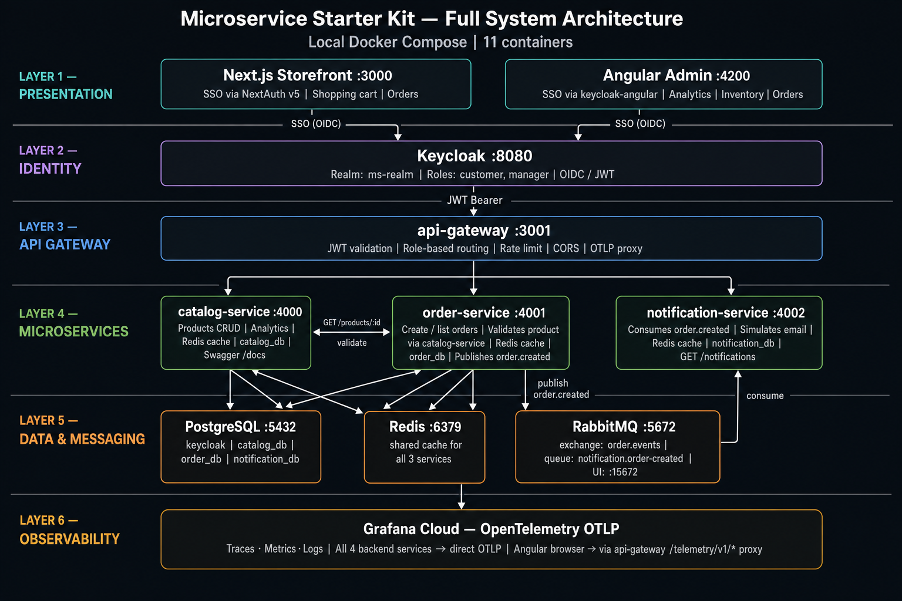

**Layer summary:**

| Layer | Components |
|-------|-----------|
| Presentation | Next.js Storefront :3000, Angular Admin Console :4200 |
| Identity | Keycloak :8080 (realm ms-realm, roles: customer / manager) |
| API Gateway | api-gateway :3001 — JWT, roles, rate-limit, CORS, OTLP proxy |
| Microservices | catalog-service :4000, order-service :4001, notification-service :4002 |
| Data & messaging | PostgreSQL :5432 (4 DBs), Redis :6379, RabbitMQ :5672 |
| Observability | Grafana Cloud via OpenTelemetry OTLP |

---

### 2.2 Order placement & notification sequence

The sequence diagram below traces a complete order — from the customer completing **Stripe Checkout** through the synchronous HTTP chain, then the asynchronous RabbitMQ event, and finally the manager reading the notification email record in the Angular Admin.

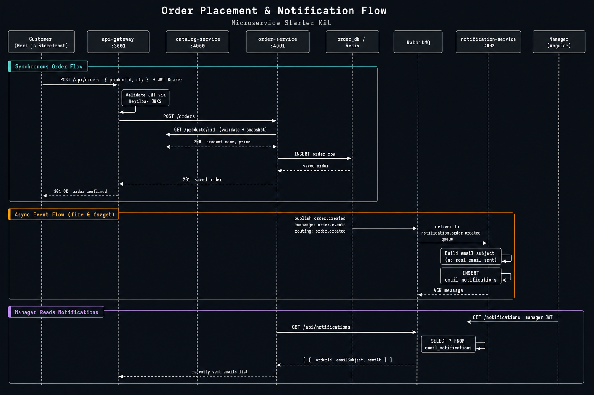

**Three phases shown:**

1. **Synchronous order flow** (teal) — Customer → Next.js → API Gateway (JWT validated) → Order Service → Catalog Service (product validation) → `order_db` → 201 OK back to customer.
2. **Async event flow — fire & forget** (amber) — Order Service publishes `order.created` to RabbitMQ. Notification Service consumes it, sends a real HTML confirmation email via SMTP (when enabled), and records the attempt in `notification_db` (`sent`, `failed`, or `skipped`).
3. **Manager reads notifications** (purple) — Angular Admin calls `GET /notifications` through the gateway. Notification Service queries `email_notifications` and returns the delivery log.

> The customer receives `201 OK` before the notification service processes the event — the order response is never delayed by messaging.

---

### 2.3 Observability flow (Grafana Cloud + OpenTelemetry)

```
┌─────────────────────────────────────────────────────────────────┐
│  BACKEND (NestJS) — catalog, order, notification, api-gateway   │
│  Traces + Metrics + Logs ──OTLP HTTP──► Grafana Cloud           │
│  Config: catalog-service/.env (GRAFANA_CLOUD_* + OTEL_*)        │
└─────────────────────────────────────────────────────────────────┘

┌─────────────────────────────────────────────────────────────────┐
│  ANGULAR (browser)                                              │
│  Traces + Logs ──OTLP──► API Gateway /telemetry/v1/* ──► Grafana│
│  (Gateway proxies OTLP — avoids browser CORS issues)            │
└─────────────────────────────────────────────────────────────────┘

┌─────────────────────────────────────────────────────────────────┐
│  NEXT.JS (server-side)                                          │
│  OpenTelemetry NodeSDK — traces, metrics, logs → Grafana Cloud  │
│  Config: same OTEL_EXPORTER_OTLP_ENDPOINT + credentials         │
└─────────────────────────────────────────────────────────────────┘

```

---

## 3. Before you start

### What you need

| Requirement | Details |
|-------------|---------|
| **Computer** | Windows, Mac, or Linux |
| **Docker Desktop** | [docker.com/products/docker-desktop](https://www.docker.com/products/docker-desktop/) |
| **RAM** | 4 GB free minimum (**8 GB recommended** for all 11 containers) |
| **Terminal** | Terminal (Mac), PowerShell (Windows), or any shell |

### Install Docker Desktop

1. Download and install Docker Desktop.
2. Open it and wait until it shows **“Docker is running”**.
3. You do **not** need Node.js, PostgreSQL, Redis, or RabbitMQ installed separately.

> **First run tip:** The first `docker compose up --build` can take **5–15 minutes**. Later starts are much faster.

---

## 4. Quick start — Docker Desktop

### Step 1 — Open the project folder

Unpack or clone the kit, then open a terminal in the project root:

```bash
cd microservice-kit
```

### Step 2 — Set up environment files

Run the following three commands from the project root — that is all that is required for a local Docker Compose run:

```bash
# 1 — root database + Keycloak admin credentials
cp .env.example .env

# 2 — Next.js auth (pre-wired to the bundled Keycloak realm — no edits needed locally)
cp nextjs-app/.env.local.example nextjs-app/.env.local

# 3 — (optional) Grafana Cloud telemetry — skip if you don't want observability
cp catalog-service/.env.example catalog-service/.env
```

**Root `.env` — the only file you must edit:**

Open `.env` and replace both `CHANGE_ME` values with your own passwords. `OTEL_ENABLED` is already set to `false`, so the kit runs with zero observability overhead out of the box — leave it as-is unless you want telemetry:

```env
POSTGRES_USER=postgres
POSTGRES_PASSWORD=CHANGE_ME          # ← set any password you like
POSTGRES_DB=keycloak
KEYCLOAK_ADMIN=admin
KEYCLOAK_ADMIN_PASSWORD=CHANGE_ME    # ← set any password you like
OTEL_ENABLED=false                   # ← master telemetry switch (see section 13)
SMTP_ENABLED=false                   # ← real order emails (see section 6.13)
```

**`nextjs-app/.env.local`** — no edits needed for local Docker Compose. The values in the example file are pre-aligned with the bundled Keycloak realm (`keycloak/init-realm.json`). Optional **Stripe checkout** keys go here too — off by default (see [section 6.12](#612-stripe-payment-gateway-checkout--optional)):

```env
STRIPE_ENABLED=false
STRIPE_SECRET_KEY=
STRIPE_PUBLISHABLE_KEY=
NEXT_PUBLIC_STRIPE_PUBLISHABLE_KEY=
```

> All `.env` / `.env.local` files are gitignored. The `.example` files are tracked and document every variable.

**`catalog-service/.env` (optional)** — only needed when you want Grafana Cloud observability.

> **Turning telemetry ON is a two-part step** (full details in [section 13](#13-observability--grafana--opentelemetry)):
> 1. Set **`OTEL_ENABLED=true`** in the **root `.env`** — this is the authoritative switch for all backends, Next.js, and the Angular browser. (It overrides any `OTEL_ENABLED` inside `catalog-service/.env`.)
> 2. Add your Grafana Cloud credentials to **`catalog-service/.env`**:
>
> ```env
> GRAFANA_CLOUD_INSTANCE_ID=your-numeric-instance-id
> GRAFANA_CLOUD_API_TOKEN=glc_eyJ...
> OTEL_EXPORTER_OTLP_ENDPOINT=https://otlp-gateway-prod-ap-south-1.grafana.net/otlp
> ```

### Step 3 — Start all 11 services

```bash
docker compose up --build -d
```

### Step 4 — Wait ~60–90 seconds

```bash
docker compose ps
```

All services should show **running** / **healthy**.

### Step 5 — Verify

Open http://localhost:3000 — Storefront landing page should load.

---

## 5. Open the apps & demo logins

| Application | URL |
|-------------|-----|
| Storefront | http://localhost:3000 |
| Admin Console | http://localhost:4200 |
| Keycloak admin | http://localhost:8080 |
| API Gateway | http://localhost:3001 |
| Catalog Swagger | http://localhost:4000/docs |
| Order Swagger | http://localhost:4001/docs |
| Notification Swagger | http://localhost:4002/docs |
| RabbitMQ UI | http://localhost:15672 (guest/guest) |

| Username | Password | Role |
|----------|----------|------|
| `manager` | `manager123` | Full admin (storefront + Admin Console) |
| `customer` | `customer123` | Shop + own orders |
| `admin` | *(value of `KEYCLOAK_ADMIN_PASSWORD` in your root `.env`)* | Keycloak admin console only |

> Demo app users (`manager` / `customer`) are imported with the realm. The Keycloak **admin console** password is whatever you set for `KEYCLOAK_ADMIN_PASSWORD` in Step 2 — not a fixed kit password.

Demo users have **no prefilled email**. Add an email in Keycloak Admin → **Users** for live SMTP delivery (section 6.13).

### 5.1 Storefront before login

Open http://localhost:3000. You see the public **marketing landing** (brand, headline, CTA). Click **Sign in** (header or hero) to start Keycloak SSO — after login you land on the product catalog at `/products`.

| Route | Purpose |
|-------|---------|
| `/` | Public landing (guest) |
| `/products` | Catalog + cart (signed-in) |
| `/checkout` | Stripe Payment Element (when enabled) |
| `/orders` | My Orders (account menu) |
| `/profile` | Account / role summary |
| `/clear-cookies.html` | Local cookie cleanup helper |

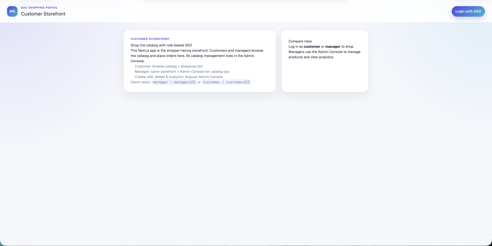

> If this screenshot shows an older dual “role card” guest layout, ignore the chrome — use **Sign in** and the route table above.

### 5.2 Admin Console before login

Open http://localhost:4200. The **Admin Console** guest screen shows role comparison cards (`manager` vs `customer`) and **Login with SSO**. That button redirects to Keycloak (same flow as section 5.3). After login, the left sidebar opens: Dashboard, Products, Orders, Notifications, Profile.

### 5.3 Keycloak SSO login

Both the Storefront and the Admin Console redirect users to the **Keycloak realm `ms-realm`** for authentication. Enter your username/password and click **Sign In**.

The login screen uses the bundled **Lattice** theme (`keycloak/themes/lattice`) — same visual language as the storefront. Compose mounts the theme; local K8s / production bake it into the Keycloak image.

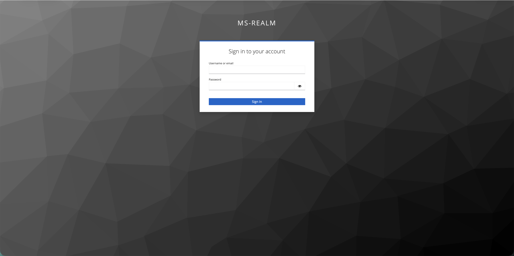

> Keycloak issues a signed JWT. The API Gateway validates every request against the Keycloak JWKS endpoint — no session is stored in the apps themselves.

---

## 6. Features explained (every module)

### 6.1 Next.js Storefront (`nextjs-app/`)
- Public marketing landing at `/` (rebrand via `nextjs-app/content/landing.ts` or `LANDING_*` env vars — see [section 6.11](#611-storefront-landing-rebrand))
- Keycloak SSO via NextAuth v5 (prefixed cookies: `authjs.storefront.*`) — CTA label **Sign in**
- Product catalog + shopping cart at `/products`
- **Stripe checkout** at `/checkout` (optional — section 6.12)
- **My Orders** at `/orders` and **Profile** at `/profile` (account menu)
- Managers shop from the storefront; catalog CRUD is in the Admin Console
- Account menu link to Admin Console via `NEXT_PUBLIC_ADMIN_CONSOLE_URL` (Compose default `:4200`; prod NodePort **30083**, baked at image build)
- OpenTelemetry instrumentation (optional)
- Helper page: http://localhost:3000/clear-cookies.html (local 431 / cookie cleanup)

### 6.2 Angular Admin Console (`angular-app/`)
- Keycloak SSO with silent check (**Login with SSO** on the guest screen)
- Left sidebar navigation (`admin-shell`):
  - **Dashboard** (`/dashboard`) — inventory and order statistics only
  - **Products** (`/products`) — manager CRUD + JSON export; customer read-only
  - **Orders** (`/orders`) — manager: all orders; customer: own orders
  - **Notifications** (`/notifications`) — manager-only email delivery log (`sent` / `failed` / `skipped`)
  - **Profile** (`/profile`) — account and role permissions
- Browser OpenTelemetry → exported via gateway OTLP proxy

### 6.3 Keycloak (`keycloak/`)
- Pre-imported realm `ms-realm` with demo users and clients
- Roles: `customer`, `manager`
- Clients: `nextjs-app`, `angular-app`
- **Lattice login theme** (`themes/lattice`) — Compose volume mount + `docker-entrypoint.sh` (`loginTheme=lattice`); K8s uses `keycloak/Dockerfile` (theme baked in)
- Forgot-password / remember-me enabled on the realm (SMTP optional — same host as notification-service)
- Ops helper: `scripts/enable-keycloak-forgot-password.sh` (wires realm SMTP from root `.env` when needed)

### 6.4 API Gateway (`api-gateway/`)
- JWT validation (Keycloak JWKS)
- Role-based routing (manager vs customer)
- Rate limiting (100 req/min default)
- CORS for frontends
- Routes: `/products`, `/orders`, `/analytics`, `/notifications`, `/health`
- OTLP proxy: `/telemetry/v1/traces`, `/telemetry/v1/logs` (for Angular browser)

### 6.5 Catalog Service (`catalog-service/`)
- Products CRUD, sample seed data
- Analytics (calls order-service for order stats)
- **Redis** cache for products/sessions
- Database: `catalog_db`
- Swagger at `/docs`

### 6.6 Order Service (`order-service/`)
- Create/list/update orders
- Validates products via catalog-service HTTP call
- **Redis** cache
- **RabbitMQ publisher** — `order.created` events after save
- Database: `order_db`

### 6.7 Notification Service (`notification-service/`)
- **RabbitMQ consumer** — queue `notification.order-created`
- **Real SMTP email delivery** when enabled (section 6.13) — HTML order confirmation via nodemailer
- Always logs attempts in `email_notifications` (`sent`, `failed`, `skipped`, `pending`)
- `STOREFRONT_URL` used in confirmation email links (Compose: `http://localhost:3000`; prod: NodePort **30080**)
- Database: `notification_db`
- **Redis** cache
- Swagger at `/docs`; exposed via gateway: `GET /notifications` (manager)

### 6.8 PostgreSQL (`postgres/`)
- Single server, four databases (see section 1.6)
- Init script: `postgres/init.sql`
- Premium editions include hardened cloud database options (RDS / managed Postgres).

### 6.9 Redis
- Used by: catalog-service, order-service, notification-service
- Product / response cache and short-lived session-style TTLs in those services
- Gateway rate limiting is **in-memory** (Nest Throttler) — not Redis-backed
- Local Compose: Redis container from `docker-compose.yml`
- Premium editions include ElastiCache / in-cluster Redis manifests.

### 6.10 RabbitMQ
- Used by: order-service (publish), notification-service (consume)
- Management UI: http://localhost:15672
- Local Compose: RabbitMQ container from `docker-compose.yml`
- Premium editions include Amazon MQ / in-cluster RabbitMQ manifests.

| Setting | Value |
|---------|-------|
| Exchange | `order.events` (topic, durable) |
| Routing key | `order.created` |
| Queue | `notification.order-created` |

### 6.11 Storefront landing rebrand

The public page at `/` is driven by `nextjs-app/content/landing.ts`. You can override copy without editing React components by setting optional `LANDING_*` variables in the root `.env` (Compose) or `nextjs-app/.env.local` — see comments in `.env.example` (`LANDING_BRAND_NAME`, `LANDING_HEADLINE`, CTA labels/hrefs, etc.).

### 6.12 Stripe payment gateway (checkout — optional)

**Off by default.** Both must be true: `STRIPE_ENABLED=true` and valid Stripe test keys in **`nextjs-app/.env.local`**.

| When disabled | When enabled |
|---------------|--------------|
| Cart shows **Checkout unavailable** | Cart → **Checkout** → `/checkout` (Stripe Payment Element) |
| No PaymentIntent created | Order placed only after payment succeeds |
| No order via payment flow | Order status **`confirmed`** immediately |

**Enable:**

1. Get test keys from [Stripe Dashboard → API keys](https://dashboard.stripe.com/test/apikeys) (test mode)
2. Edit `nextjs-app/.env.local`:

```env
STRIPE_ENABLED=true
STRIPE_SECRET_KEY=sk_test_...
STRIPE_PUBLISHABLE_KEY=pk_test_...
NEXT_PUBLIC_STRIPE_PUBLISHABLE_KEY=pk_test_...
```

3. Restart: `docker compose up -d --build nextjs-app`
4. Test card: `4242 4242 4242 4242` · any future expiry · any CVC

> Prefer setting both publishable key forms: `STRIPE_PUBLISHABLE_KEY` is read at Docker runtime; `NEXT_PUBLIC_STRIPE_PUBLISHABLE_KEY` is also supported (`docker-entrypoint.sh` aliases them).

**Flow:**

```
My Cart → POST /api/payments/create-intent → Stripe PaymentIntent
       → Customer pays on /checkout
       → POST /api/orders (verifies PaymentIntent)
       → order-service (confirmed) → RabbitMQ order.created
```

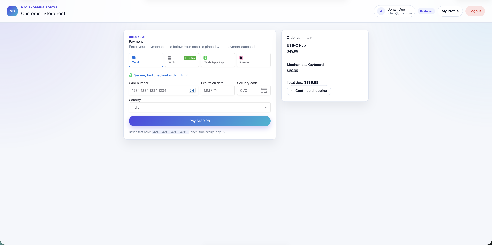

### 6.13 Real email delivery (SMTP — optional)

**Off by default.** Both must be true: `SMTP_ENABLED=true` and `SMTP_HOST` set in **root `.env`**.

| When disabled | When enabled |
|---------------|--------------|
| Row inserted on **Notifications** page | Real HTML confirmation email sent |
| Status **`skipped`** | Status **`sent`** (or **`failed`** with error in logs) |

**Enable:**

```env
SMTP_ENABLED=true
SMTP_HOST=smtp.gmail.com
SMTP_PORT=587
SMTP_USER=your.email@gmail.com
SMTP_PASS=your_gmail_app_password
SMTP_SECURE=false
EMAIL_FROM=Microservice Storefront <your.email@gmail.com>
```

Restart: `docker compose up -d --build notification-service`

For dev without a real inbox, use [Mailtrap](https://mailtrap.io) (`SMTP_HOST=sandbox.smtp.mailtrap.io`). Gmail requires an [App Password](https://myaccount.google.com/apppasswords).

**Customer email:** add email in Keycloak Admin → **Users** → `customer`. User must **re-login** after the email is set.

| Status | Meaning |
|--------|---------|
| `sent` | Delivered via SMTP |
| `failed` | SMTP on but send failed — check `docker compose logs notification-service` |
| `skipped` | SMTP off, missing creds, or no customer email in Keycloak |
| `pending` | Send in progress |

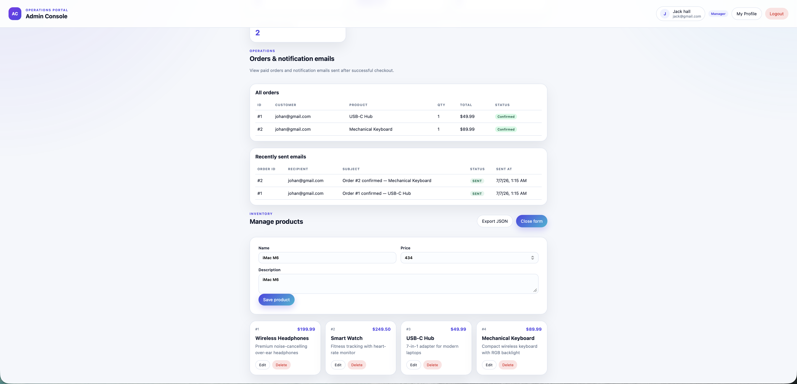

### 6.14 Security (all layers)
- Gateway: JWT + roles + throttling
- Microservices: JWT on every request
- K8s prod: NetworkPolicies per service
- Keycloak: realm roles, front-channel logout

---

## 7. Try the full demo workflow

This walkthrough exercises the kit end-to-end: Stripe checkout (when enabled), order confirmation, SMTP email (when enabled), and the Admin Console.

> Enable Stripe and SMTP first — [section 6.12](#612-stripe-payment-gateway-checkout--optional) and [section 6.13](#613-real-email-delivery-smtp--optional). Without Stripe, checkout is unavailable. Without SMTP, emails show status **`skipped`**.

---

### Step 1 — Start the stack

```bash
docker compose up --build -d
# Wait ~90 seconds until docker compose ps shows all services healthy
```

---

### Step 2 — Customer builds a cart (Storefront)

Open http://localhost:3000 → click **Sign in** → authenticate as **customer / customer123**.

You are redirected to **`/products`**. Browse the catalog (four seeded products on a fresh DB) and click **Add to cart**.

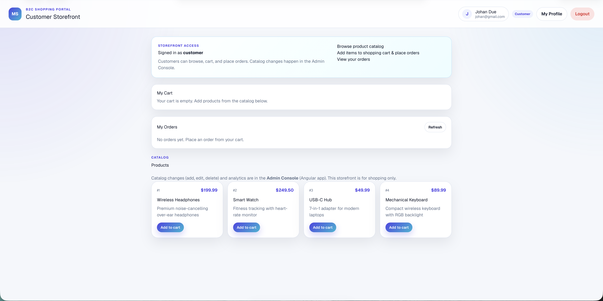

> Live UI: catalog + cart on `/products` with an account menu. Older screenshots may still show a single-page portal layout.

The cart shows a live total and a **Checkout** button (when Stripe is enabled).

---

### Step 3 — Customer pays with Stripe

On `/products`, add items to the cart, then click **Checkout**.

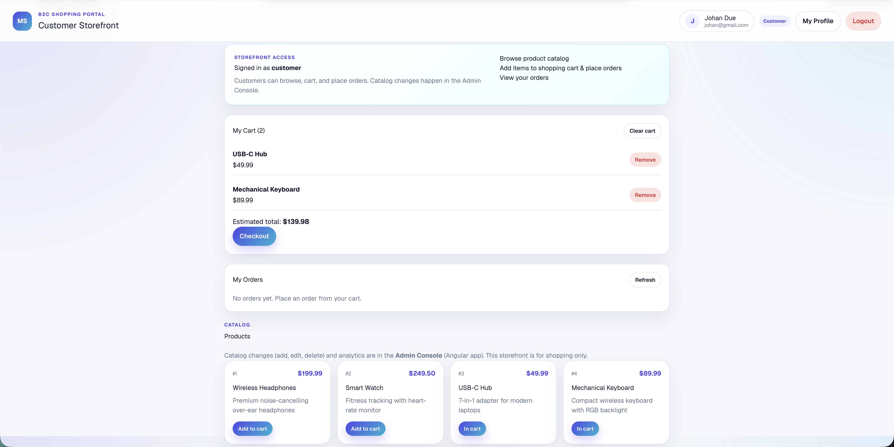

Pay on `/checkout` with test card **`4242 4242 4242 4242`**.


On success, the order is **`confirmed`** and a confirmation email is queued (SMTP).

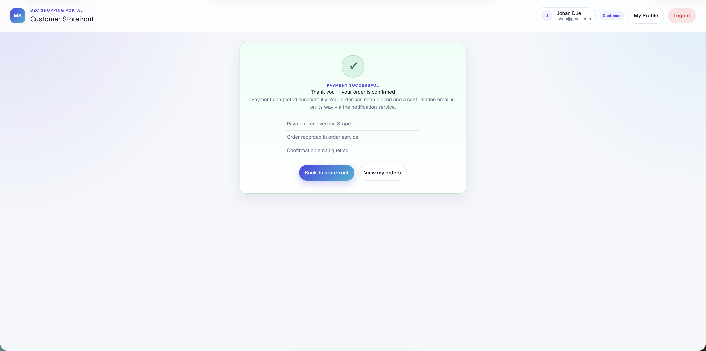

What happened behind the scenes:

1. Next.js creates a Stripe PaymentIntent and verifies payment server-side
2. `POST /orders` → **API Gateway** → **Order Service** (status **`confirmed`**, not pending)
3. Order Service publishes `order.created` to **RabbitMQ**
4. **Notification Service** sends SMTP email (if enabled) and logs the result

After success, open **My Orders** from the account menu (route **`/orders`**) or the success-page link to see **`confirmed`** purchases.

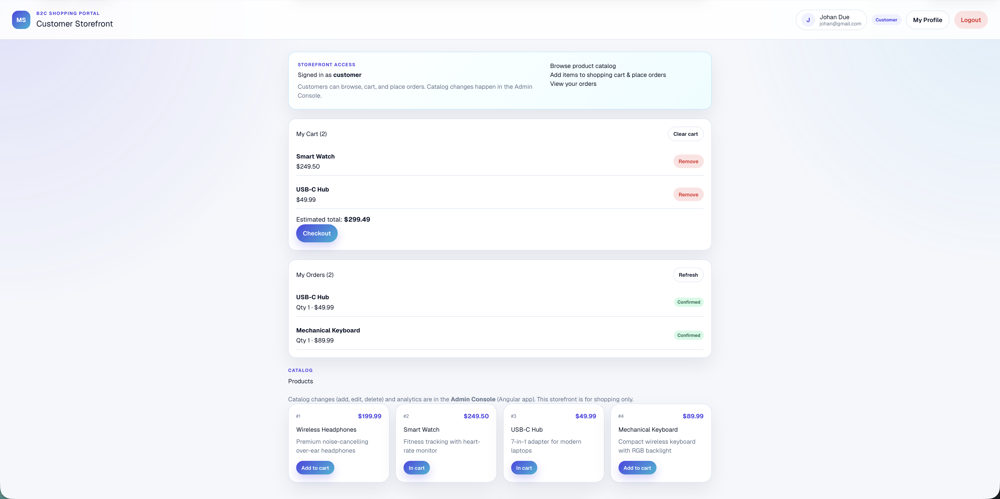

---

### Step 4 — Manager shops on the Storefront (optional)

Sign in as **manager / manager123**. Managers use the same storefront routes (`/products`, `/checkout`, `/orders`) as customers — catalog CRUD stays in the Admin Console.

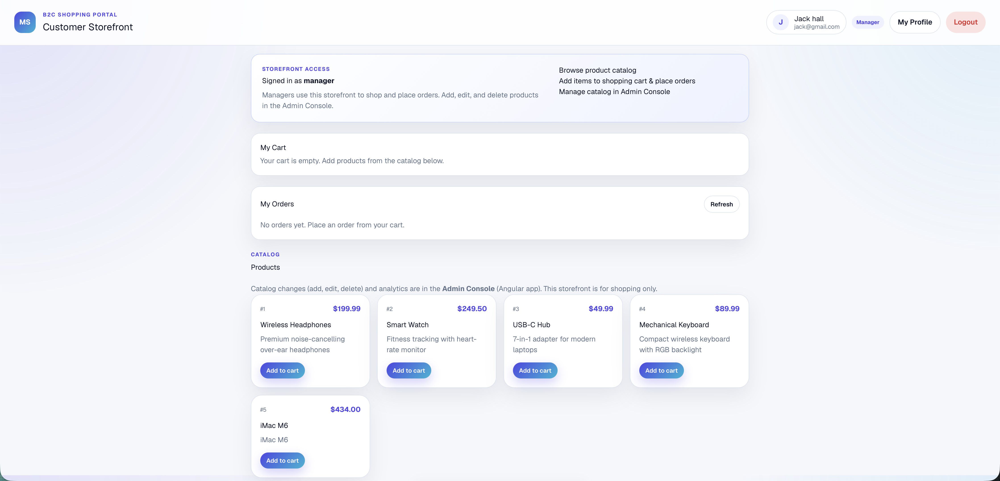

---

### Step 5 — Manager reviews orders & notifications (Admin Console)

Sign in as **manager / manager123** on http://localhost:4200. Use the **left sidebar**:

- **Dashboard** — inventory and order statistics only
- **Orders** — paid checkouts appear as **`confirmed`**
- **Notifications** — **`sent`** when SMTP is enabled, **`skipped`** when off
- **Products** — catalog CRUD and JSON export

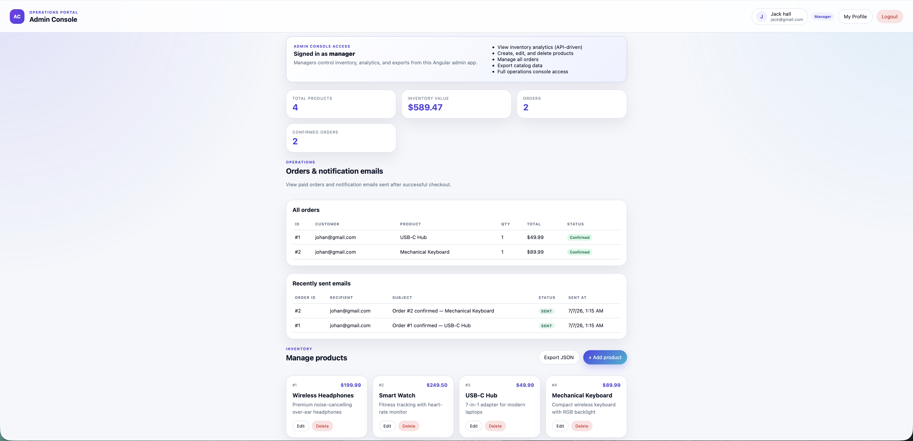


> Live Admin Console uses the **sidebar** routes above. Older screenshots may still show a single-page layout — use the sidebar labels, not the old page chrome.

---

### Step 6 — Customer read-only Admin Console (optional)

Sign in as **customer** on http://localhost:4200 — use **Products** (read-only) and **Orders** in the sidebar. **Notifications** stays manager-only.

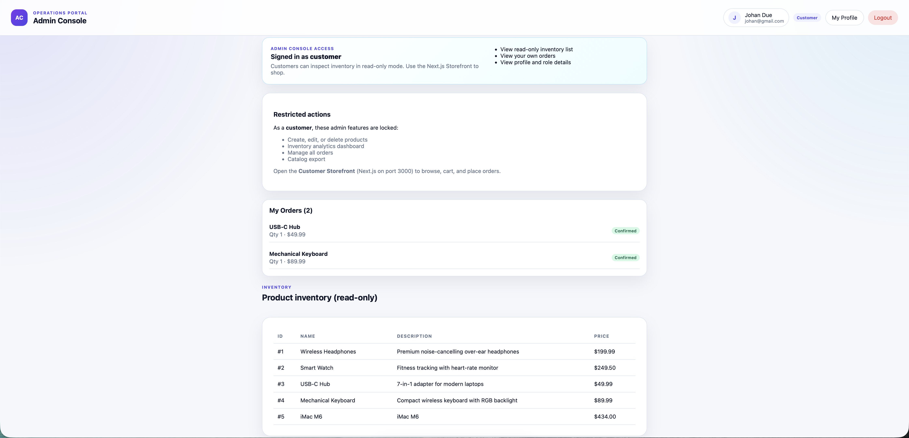

---

### Step 7 — Profile & permissions (optional)

Open **Profile** in the Admin Console sidebar (or storefront `/profile`). It shows role details and which Admin Console features are allowed or locked.

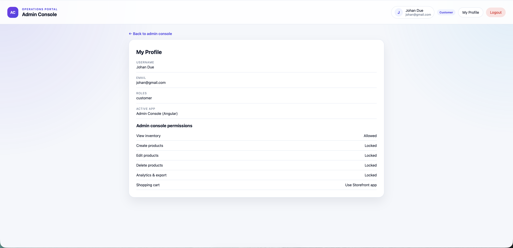

---

### Step 8 — Verify RabbitMQ (optional)

Open http://localhost:15672 (guest / guest) → **Queues** → `notification.order-created` — consumed count matches orders placed.

---

### Summary of what you exercised

| Step | Service touched | Feature demonstrated |
|------|-----------------|----------------------|
| Login | Keycloak | OIDC SSO, JWT issuance |
| Catalog | Next.js, Catalog | `/products` browse, localStorage cart |
| Checkout | Next.js, Stripe | Payment Element, server-side verify |
| Order | Order Service | Confirmed status, RabbitMQ publish |
| Email | Notification Service | SMTP delivery + admin log |
| Admin Console | Angular | Sidebar: Dashboard, Products, Orders, Notifications, Profile |
| Profile | Angular / Next.js, Keycloak JWT | Role-based UI |

---

## 8. API reference (via gateway)

**Base URL:** `http://localhost:3001`

| Method | Path | Role | Description |
|--------|------|------|-------------|
| `GET` | `/health` | public | Gateway health |
| `GET` | `/products` | authenticated | List products |
| `GET` | `/products/:id` | authenticated | Get product |
| `POST` | `/products` | manager | Create product |
| `PATCH` | `/products/:id` | manager | Update product |
| `DELETE` | `/products/:id` | manager | Delete product |
| `POST` | `/orders` | authenticated | Place order |
| `GET` | `/orders/mine` | authenticated | My orders |
| `GET` | `/orders` | manager | All orders |
| `PATCH` | `/orders/:id/status` | manager | Update status |
| `GET` | `/analytics/summary` | manager | Dashboard analytics |
| `GET` | `/notifications` | manager | Sent email records |
| `POST` | `/telemetry/v1/traces` | public | OTLP trace proxy (browser) |
| `POST` | `/telemetry/v1/logs` | public | OTLP log proxy (browser) |

### 8.1 Swagger UI (per microservice)

Each backend service exposes interactive Swagger in local/dev mode. The **API gateway does not host Swagger** — use direct service URLs:

| Service | Swagger URL |
|---------|-------------|
| Catalog | http://localhost:4000/docs |
| Order | http://localhost:4001/docs |
| Notification | http://localhost:4002/docs |

Protected routes require a Keycloak Bearer JWT — click **Authorize** in Swagger.

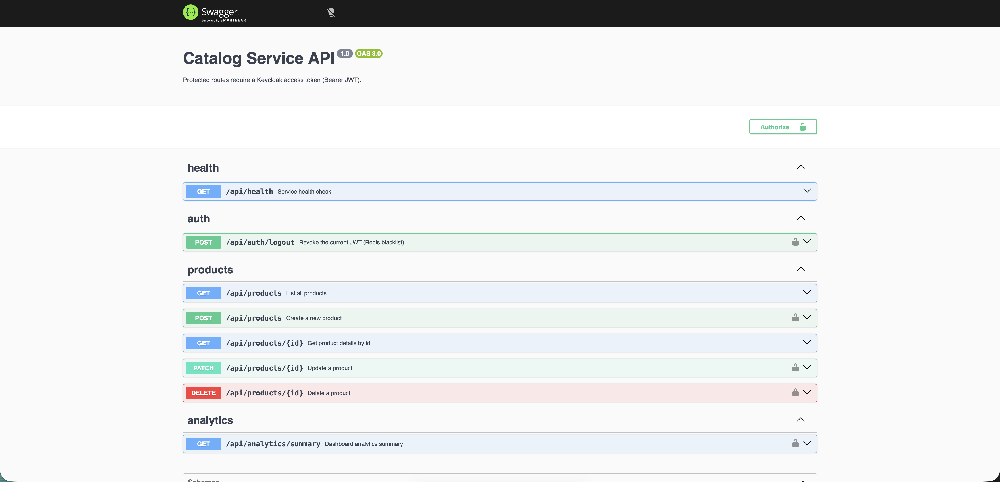

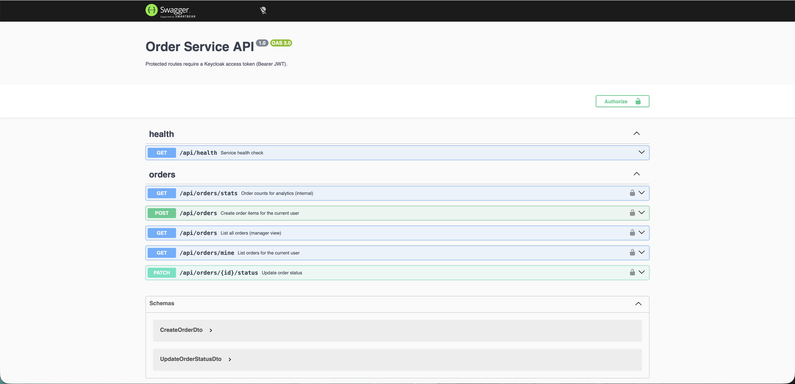

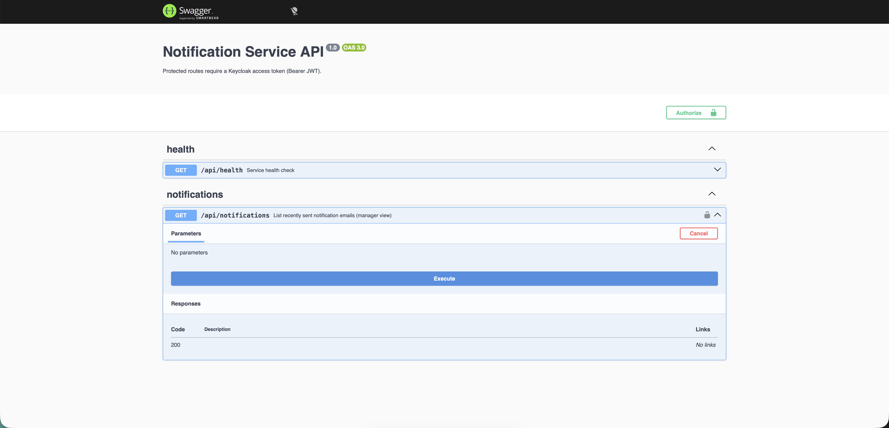

---

## 9. Docker Compose command reference

```bash
docker compose up --build -d      # Start all 11 services
docker compose ps                 # Status
docker compose logs -f            # All logs
docker compose logs -f rabbitmq   # RabbitMQ only
docker compose down               # Stop (keep data)
docker compose down -v            # Stop + wipe DBs (fresh start)
```

Rebuild one service:

```bash
docker compose build notification-service && docker compose up -d notification-service
```

---

## 10. Observability — Grafana & OpenTelemetry

Every service in the kit ships with **OpenTelemetry** instrumentation out of the box. Traces, metrics, and logs are exported directly to **Grafana Cloud** over OTLP HTTP — no sidecar or collector required.

### 10.1 Coverage

| Component | Traces | Logs | Metrics | Export path |
|-----------|--------|------|---------|-------------|
| api-gateway | yes | yes | yes | Direct → Grafana Cloud OTLP |
| catalog-service | yes | yes | yes | Direct → Grafana Cloud OTLP |
| order-service | yes | yes | yes | Direct → Grafana Cloud OTLP |
| notification-service | yes | yes | yes | Direct → Grafana Cloud OTLP |
| angular-app (browser) | yes | yes | — | Via api-gateway `/telemetry/v1/*` proxy |
| nextjs-app (server) | yes | yes | yes | Direct → Grafana Cloud OTLP |

### 10.2 Enable or disable telemetry

Telemetry is **off by default**. Every service and both frontends read a single master switch, **`OTEL_ENABLED`**, so you only turn it on when you actually want to ship traces and logs to Grafana.

**Step 1 — flip the master switch.** Set `OTEL_ENABLED` in the **root `.env`** file (this is the authoritative value — Docker Compose injects it into all backend services, the Next.js server, and the Angular browser app):

```env
# .env  (project root)
OTEL_ENABLED=true      # false (default) = no telemetry, zero OTLP network calls
```

**Step 2 — add Grafana Cloud credentials** to **`catalog-service/.env`** (all backend services read the same env block; the Angular browser exports through the api-gateway OTLP proxy):

```env
# catalog-service/.env
GRAFANA_CLOUD_INSTANCE_ID=123456
GRAFANA_CLOUD_API_TOKEN=glc_eyJ...
OTEL_EXPORTER_OTLP_ENDPOINT=https://otlp-gateway-prod-ap-south-1.grafana.net/otlp
```

**Step 3 — rebuild and restart** so the new value is baked in:

```bash
docker compose up --build -d
```

#### What each state does

| `OTEL_ENABLED` | Backends (gateway, catalog, order, notification) | Next.js server | Angular browser |
|----------------|--------------------------------------------------|----------------|-----------------|
| `false` (default) | OTel SDK never starts; no exporters | OTel SDK never starts | `initBrowserOtel()` returns early — **no `/telemetry/v1/*` calls** |
| `true` | Export directly to Grafana Cloud OTLP | Export directly to Grafana Cloud OTLP | Export via api-gateway `/telemetry/v1/*` proxy |

> **Notes**
> - The switch is checked at startup. When it is `false`, no OTLP HTTP requests are made anywhere — the app runs cleanly with no console noise and no `503` from the telemetry endpoints.
> - `OTEL_ENABLED` in the root `.env` **overrides** the value in `catalog-service/.env`, so use the root file as your single toggle.
> - If you set `OTEL_ENABLED=true` but omit the Grafana credentials, backends and the gateway skip forwarding gracefully (a single startup warning, no errors).

---

### 10.3 Traces — Drilldown view

The **Grafana Drilldown → Traces** view shows request spans broken down by `resource.service.name`. You can see traces from all 6 services side by side — `nextjs-app`, `api-gateway`, `catalog-service`, `angular-app`, `notification-service`, and `order-service` — with span rate and error rate plotted over time. Click any service tile to filter traces by that service and drill into individual spans.

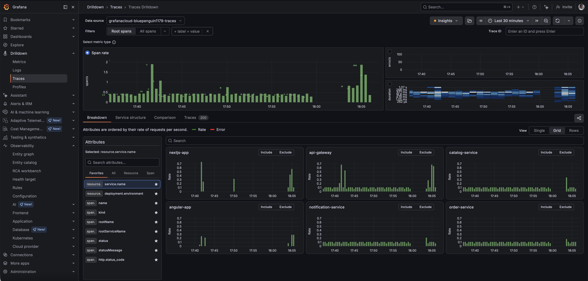

### 10.4 Metrics — Auto-discovered panels

The **Grafana Drilldown → Metrics** view auto-discovers all OTLP metric series emitted by the services. Panels include HTTP client/server durations, Redis eventloop delay, Node.js GC duration, heap usage, and more. These come from `getNodeAutoInstrumentations()` with no manual metric definitions required.

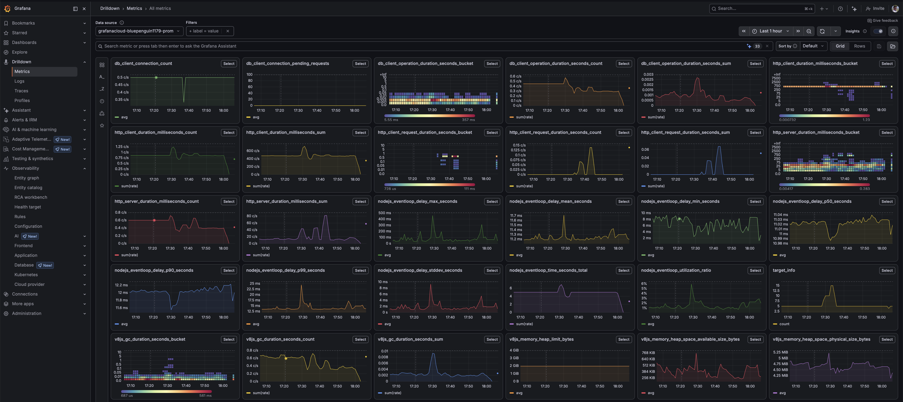

### 10.5 Logs — Structured log stream

The **Grafana Drilldown → Logs** view groups log lines by service. Each log entry carries the structured `event` attribute that all services use (e.g., `event=products.fetch`, `event=order.create`, `event=storefront.load`). You can see entries from `api-gateway`, `catalog-service`, `order-service`, `notification-service`, `nextjs-app`, and `angular-app` in a single timeline, filterable by service, severity, or any attribute.

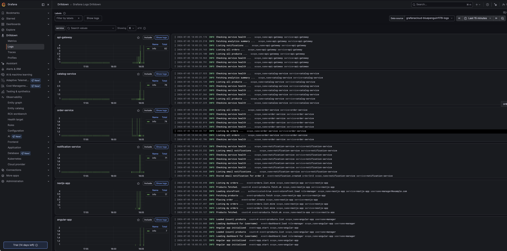

---

## 11. Troubleshooting

| Problem | Fix |
|---------|-----|
| Containers won't start | Docker Desktop running? `docker compose ps` + `logs` |
| Keycloak shows stock (non-Lattice) login UI | Compose: ensure theme volume + `docker compose up -d --build keycloak`. Local K8s: rebuild without `--skip-build` so `microservice-kit/keycloak:local` includes Lattice; use `--recreate` if the realm was imported before `loginTheme` was set. |
| Keycloak login loop | Clear cookies for `localhost` (ports 3000/8080/4200), or open http://localhost:3000/clear-cookies.html; wait 90s; `docker compose down -v` if needed |
| HTTP **431** (Request Header Fields Too Large) | Same cookie pile-up on `localhost` — use clear-cookies.html, then retry logout/checkout |
| 401 from API | Re-login; check Keycloak :8080 |
| Empty products | Wait for catalog-service healthy |
| Checkout unavailable | Set `STRIPE_ENABLED=true` + Stripe keys in `nextjs-app/.env.local` (`STRIPE_PUBLISHABLE_KEY` and/or `NEXT_PUBLIC_STRIPE_PUBLISHABLE_KEY`); `docker compose up -d --build nextjs-app` (section 6.12) |
| Stripe error on pay | Test card `4242 4242 4242 4242`; disable ad blockers for hCaptcha |
| Email status `skipped` | Set `SMTP_ENABLED=true` + SMTP vars in root `.env`; add customer email in Keycloak; re-login (section 6.13) |
| Email status `failed` | `docker compose logs notification-service`; verify Gmail App Password or Mailtrap |
| No emails on Notifications page | Open Admin Console → **Notifications**; wait for notification-service + RabbitMQ; check logs |
| RabbitMQ connection slow | Normal — background retry on startup |
| Redis errors in logs | Usually transient during startup |
| CORS errors | Frontends must use gateway :3001 |
| Port in use | Free 3000, 3001, 4000–4002, 4200, 5432, 5672, 6379, 8080 |
| `503` on `/telemetry/v1/*` or unwanted trace/log calls | Telemetry is off by default. Set `OTEL_ENABLED=true` in the root `.env` only if you want it (section 13); when off, no OTLP calls are made and the gateway skips forwarding without erroring |
| Angular shows a "Configuration error" page | `window.__ENV` didn't load or Keycloak is unreachable — check the `angular-app` container started and `env.js` is served, and that Keycloak :8080 is up with realm `ms-realm` |
| A service exits on startup with a missing-env message | A required variable (DB, Keycloak, or NextAuth secret) is unset — copy the matching `*.env.example` and fill it in before starting |
| Prod Keycloak ImagePullBackOff | Create `jfrog-secret` on the cluster; Keycloak uses the private Lattice image (not public quay.io) |

---

## 12. Security checklist (local → real deploy)

**Credentials & secrets**
- [ ] Copy `.env.example` → `.env` and set strong unique passwords before first run
- [ ] Create cluster `jfrog-secret` before deploying Keycloak or app images
- [ ] Rotate Keycloak demo user passwords (`manager123`, `customer123`) in `keycloak/init-realm.json` or via Keycloak admin console
- [ ] Replace the default `AUTH_SECRET` in `nextjs-app/.env.local` with a cryptographically random value
- [ ] Set Stripe / SMTP secrets only if those features are enabled in production
- [ ] Rotate the `jfrog-secret` Docker pull credentials on the cluster

**Infrastructure**
- [ ] Enable HTTPS; configure Keycloak hostname for your domain
- [ ] Disable TypeORM `synchronize: true` in all services — use migrations
- [ ] Do not expose Postgres, Redis, RabbitMQ ports publicly
- [ ] For Kubernetes / Terraform / CI/CD paths, upgrade to a Premium edition

**Observability & security**
- [ ] Set up Grafana alerts for error rate and latency (if using OTel)
- [ ] Enable Keycloak MFA / brute-force protection in realm settings
- [ ] Review NetworkPolicies in K8s manifests — tighten ingress rules for your environment

---

## Quick reference

```bash
# ── First time after unpacking / cloning ────────────────────────
cp .env.example .env                                    # edit CHANGE_ME; SMTP_ENABLED=false by default
cp nextjs-app/.env.local.example nextjs-app/.env.local  # Keycloak + optional Stripe (section 6.12)
cp catalog-service/.env.example catalog-service/.env    # optional: only if OTEL_ENABLED=true

# ── Daily use ───────────────────────────────────────────────────
docker compose up --build -d    # Start all 11 services
docker compose ps               # Check status
docker compose logs -f          # Stream all logs
docker compose down -v          # Full reset (wipes DB data)
```

Guide sources: [Microservice-Starter-Kit-Guide.md](Microservice-Starter-Kit-Guide.md) · screenshots: [screenshots/](screenshots/)  
Buyer PDF (repo root): [`../Microservice-Starter-Kit-Guide.pdf`](../Microservice-Starter-Kit-Guide.pdf)

| Layer | Modules |
|-------|---------|
| Frontends | nextjs-app, angular-app |
| Identity | keycloak |
| Gateway | api-gateway |
| Services | catalog-service, order-service, notification-service |
| Data | postgres, redis, rabbitmq |
| Premium | Kubernetes · Helm · Terraform · CI/CD — [cyberinfoware.com](https://www.cyberinfoware.com) |

**Upgrade path:** [cyberinfoware.com/products](https://www.cyberinfoware.com/products#pricing) for Premium V1 / V2 / V3.

---

## 13. Upgrade to Premium

Community Edition is Docker Compose–first. Premium editions from [CyberInfoware](https://www.cyberinfoware.com) add:

- Kubernetes deployment
- Terraform
- Production CI/CD
- Helm Charts
- Enterprise documentation
- Production deployment guide
- DevOps automation
- Future updates
- Priority support

Compare editions: [EDITIONS.md](../EDITIONS.md) · [Products](https://www.cyberinfoware.com/products#pricing)

## 14. License & commercial usage


### Commercial License

By purchasing this product, you are granted a **non-exclusive, non-transferable commercial license** to use the Microservice Starter Kit.

### You may

| ✅ Permitted | Details |
|-------------|---------|
| Personal projects | Build unlimited personal projects |
| Commercial projects | Build unlimited commercial projects |
| Modification | Modify the source code to fit your needs |
| Deployment | Deploy to any cloud provider or infrastructure |
| Client work | Use the starter kit for client projects |
| Privacy | Keep your modifications private |

### You may not

| ❌ Prohibited | Details |
|--------------|---------|
| Redistribution | Redistribute the source code in any form |
| Resale | Resell this product, in whole or in part |
| Sharing | Share the source code with third parties who have not purchased a license |
| Publishing | Publish the complete project publicly (e.g. in a public repository) |
| Derivative kits | Create competing boilerplates, templates, or starter kits based primarily on this project |
| Transfer | Transfer or sublicense your license to another person or organization |

### Ownership

This product remains the intellectual property of the author. Your license grants usage rights only — it does not transfer ownership of the source code or any part of the product.

### Disclaimer

This software is provided "as is", without warranty of any kind, express or implied. In no event shall the author be liable for any claim, damages, or other liability arising from the use of this software.

**Questions about licensing?** Contact [cyberInfoware@gmail.com](mailto:cyberInfoware@gmail.com).

---

*Microservice Starter Kit Community Edition v1.1.0 · See also [README.md](../README.md), [CHANGELOG.md](../CHANGELOG.md), [EDITIONS.md](../EDITIONS.md)*

---

*Built and maintained by **Jaswant** · [cyberInfoware@gmail.com](mailto:cyberInfoware@gmail.com)*
